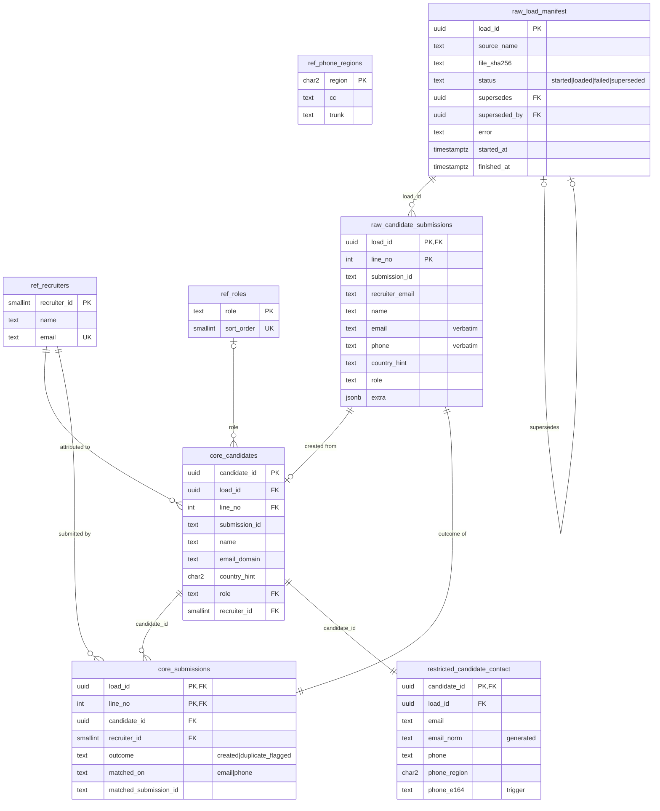

# Warehouse — schema, ERD, data dictionary

The PostgreSQL layer under the intake pipeline: the same 20 submissions that
drive the n8n tests, loaded into a four-schema model where contact details
are physically separated from everything an analyst needs.

```
warehouse/
  migrations/     001_schemas … 006_roles, numbered, applied once each
  migrate.py      applies them, hash-checked
  load.py         the loader: file → hash → manifest → raw → validate → dedupe → core/restricted
  conn.py         the three identities (admin / loader / analyst), password or Entra token
  azure/provision.sh   the Azure resources as az commands
tests/test_warehouse.py   W1–W9, `pytest -m warehouse`
```

## ERD



Schema boundaries, which the ERD cannot show but the grants enforce:

| schema | holds | `wh_loader` | `wh_analyst` |
|---|---|---|---|
| `ref` | recruiters, roles, phone regions, normalization functions | SELECT | SELECT |
| `raw` | manifest + verbatim rows (contain email/phone) | SELECT, INSERT; UPDATE on manifest status columns only | **no USAGE** |
| `core` | deduplicated candidates, submissions, current-load views | SELECT, INSERT | SELECT |
| `restricted` | contact details, dedupe keys | SELECT, INSERT | **no USAGE** |

Nobody but the migration owner can DELETE, TRUNCATE, or DROP. W6 asserts the
analyst column; W7 asserts the loader row.

## Data dictionary

### `raw.load_manifest` — one row per load attempt

| column | type | meaning |
|---|---|---|
| `load_id` | uuid | identity of the load; every row it produced carries it |
| `source_name` | text | file basename. One current (`loaded`) load per source |
| `source_path` | text | where the file was read from |
| `file_sha256` | text | hash of the bytes. One current load per hash: the same file is never loaded twice |
| `file_bytes` | bigint | size, for the record |
| `row_count` | int | data rows, set when `loaded` |
| `status` | text | `started` → `loaded` → `superseded`, or `started` → `failed`. Never goes back |
| `supersedes` / `superseded_by` | uuid | the correction chain. `superseded` ⇔ `superseded_by` set |
| `error` | text | itemized reasons, `failed` only. May quote input, so analysts do not see this column (`core.v_loads` omits it) |
| `loaded_by` | text | `current_user` at insert |
| `started_at` / `finished_at` | timestamptz | |

### `raw.candidate_submissions` — one row per input line, verbatim

| column | type | meaning |
|---|---|---|
| `load_id`, `line_no` | uuid, int | primary key. `line_no` 1 = first data row |
| `submission_id` … `note` | text | the file's columns, untouched (whitespace, case, formatting) |
| `role` | text | the role the intake pipeline settled on. The fixture calls this column `expected_role`; the loader accepts that name |
| `extra` | jsonb | every column the loader does not model, so the row is complete |

### `core.candidates` — one row per distinct person per load

| column | type | meaning |
|---|---|---|
| `candidate_id` | uuid | |
| `load_id`, `line_no` | | the raw line that created this candidate (the first sighting) |
| `submission_id` | text | that line's id |
| `name` | text | as submitted |
| `email_domain` | text | derived. The domain alone is kept in `core` because it is the routing signal for the fuzzy-name rule in the n8n pipeline and is not by itself contact data |
| `country_hint` | char(2) | as submitted |
| `role` | text → `ref.roles` | nullable: a line may arrive before a role is decided |
| `recruiter_id` | → `ref.recruiters` | **attribution: the first submitter.** A later duplicate from another recruiter does not move it (T11) |

### `core.submissions` — every input line, exactly once

| column | type | meaning |
|---|---|---|
| `load_id`, `line_no` | | primary key, FK to the raw line |
| `candidate_id` | uuid | the candidate this line created or collided with |
| `recruiter_id` | | who submitted this line (may differ from the candidate's attribution) |
| `outcome` | text | `created` or `duplicate_flagged` |
| `matched_on` | text | `email` or `phone`; the key that collided. Email is checked first |
| `matched_submission_id` | text | the earlier line it collided with |

### `restricted.candidate_contact` — one row per candidate

| column | type | meaning |
|---|---|---|
| `candidate_id` | uuid | PK, FK |
| `email` | text | as submitted |
| `email_norm` | text | **generated column**: `lower(btrim(email))`. Cannot disagree with `email` |
| `phone`, `phone_region` | text, char(2) | as submitted; region = `country_hint` |
| `phone_e164` | text | **set by trigger** from `ref.phone_e164(phone, phone_region)`; `''` when not parseable with confidence |

Unique per `load_id`: `email_norm`, and `phone_e164` where not empty.

### `core.v_candidates`, `core.v_submissions`, `core.v_loads`

What analysts query. Each joins to the manifest on `status = 'loaded'`, so
rows from superseded or failed loads stay on disk but are not visible.
`v_candidates.duplicate_attempts` counts the flagged lines per candidate.

### `ref.*`

`recruiters` (4), `roles` (Setter, Closer, Coach, Full Cycle), `phone_regions`
(the same 12-row table as `REGIONS` in `n8n/normalize.js`; W8 fails if they
drift). Seeded by migration, not by the loader.

## Loader rules

1. Same bytes as a current load → **refused**, exit 2, nothing written.
2. Same `source_name` as a current load, different bytes → refused unless
   `--supersede`; with it, the old load becomes `superseded` in the same
   transaction that makes the new one `loaded`.
3. Any line failing validation (empty name, malformed email, unknown
   recruiter, unknown role, unparseable phone) → **the whole load fails**,
   exit 1, every failing line listed. The manifest row records the list;
   no raw/core/restricted row for that `load_id` exists afterwards (W4).
4. Dedupe is in file order, `email_norm` first then `phone_e164`, against
   lines earlier in the same load. It does not look at other loads: a load
   is a complete picture of its source, and superseding replaces it whole.

## What `data/candidates.csv` produces

| | |
|---|---|
| lines | 20 |
| candidates | 14 |
| duplicates flagged | 6 — S15→S01 (email), S16→S02 (phone), S17→S03 (email), S18→S11 (phone), S19→S08 (email), S20→S10 (email) |
| `core.submissions` rows | 20 (14 `created` + 6 `duplicate_flagged`) |

These are the outcomes the fixture's `expected_*` columns already state and
that the n8n integration tests check against Notion; W2 checks them against
the warehouse. The fuzzy-name case (S12 vs S04, similarity 0.875 → Review) is
a pipeline-time decision and is not re-derived here; S12 is a candidate of
its own.
